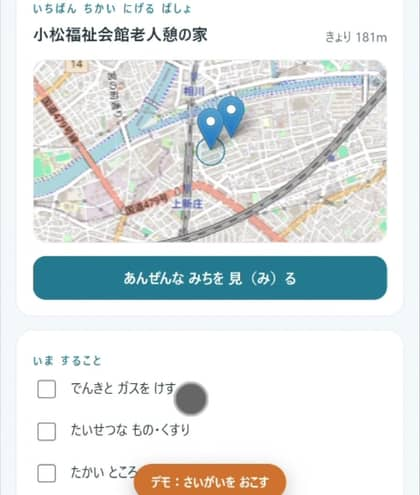
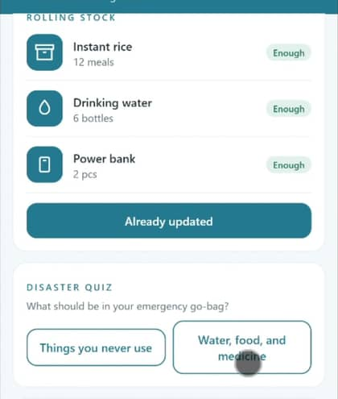

# Sonaeru (ソナエル)

**One disaster-preparedness app for every phase: prepare, protect, recover.**
A hackathon project, built solo. Works in Japanese, easy Japanese (やさしい日本語), English and Nepali.

<p>
  
  
</p>

## Why

Disaster information is split across many sites and apps, mostly in Japanese, and people who do not read Japanese
easily (residents from abroad, travellers) can be left behind. Sonaeru puts the basics in one place, in the
language of the person using it, and changes what it shows as the situation changes.

## What it does

| Phase | Tab | What you get |
|---|---|---|
| Prepare (そなえる) | Prepare | Supplies list to keep stocked, disaster quiz with points, family evacuation plan, links to official hazard maps |
| Protect (まもる) | Protect | The nearest shelter on a map with distance and a safe-route button, and a short list of what to do now |
| Recover (たすかる) | Recover | Nearby shelters, water points, supplies and food shops, and official information links |
| Connect (つながる) | Connect | Optional account to share your safety status and keep a list of family and friends |

- The screen switches to the protect phase by itself when the weather turns heavy (heavy rain or storm).
  A button in the app can also switch phases by hand, to try the app without a real disaster.
- Live location, so shelters and shops are the ones near you.
- Installable web app (PWA). The app itself is cached, and the last weather is kept, so it still opens without a network.

## Try it

The main version is the **web app**: a static site, with no build step and no server code.

```sh
python -m http.server 8000
```

Open <http://localhost:8000>. The location and the offline cache need `localhost` or HTTPS.

Add `?demo=1` to the address (for example <http://localhost:8000/?demo=1>) to pretend you are at Tokyo Tower.
This is for screen recordings, so the real location is never used.

### Android version (early)

The folder `app/` holds an Android version (Kotlin and Jetpack Compose, version 1.0). It has the same five screens
(Home, Prepare, Protect, Recover, Connect), takes the weather from Open-Meteo and shows maps through Google Maps in a
WebView. It is an early port: it is not published anywhere, and it does not have everything the web app has.
To try it, open this folder in Android Studio and run the `app` module.

## Where the data comes from

| What | Source |
|---|---|
| Map | [Leaflet](https://leafletjs.com/) with OpenStreetMap tiles |
| Nearby shelters, water, shops | [OpenStreetMap](https://www.openstreetmap.org/) through the Overpass API |
| Weather | [Open-Meteo](https://open-meteo.com/) |
| Place name for your location | Nominatim (OpenStreetMap) reverse lookup |
| Official warnings and hazard maps | Links to the Japan Meteorological Agency and the GSI Hazard Map Portal (not copied into the app) |

## Please read: honest limits

- **It is not an official source.** Always follow the instructions of your local government and the Japan
  Meteorological Agency. OpenStreetMap data can be incomplete, so a place shown as a shelter is not
  guaranteed to be an official evacuation site.
- **The automatic phase switch uses the weather only.** It does not read official warnings.
- **Your location leaves the device.** To find shelters, weather and the place name, the app sends your coordinates to
  the Overpass API, Open-Meteo and Nominatim. Nothing else is sent, and the app has no server of its own.
- **Accounts stay on the device.** Accounts, contacts, safety status and the evacuation plan are stored in the browser
  of the device (`localStorage`) and are never shared with anyone. Passwords are salted and hashed in the browser,
  which is fine for a demo and not enough for a real service.
- **The sign-up code is a demo.** The code shown during sign-up is made on the device and displayed on screen.
  No email or SMS is sent.
- Ideas from the pitch that are **not built**: registering supplies with a barcode, and switching phases from
  official warnings.

## Files

| File | What |
|---|---|
| `index.html` | The whole web app (styles, scripts and the texts in four languages) |
| `sw.js` | Service worker (offline cache) |
| `manifest.json`, `icon-*.png` | Install settings and icons |
| `app/`, `build.gradle.kts`, `settings.gradle.kts`, `gradle/` | The Android version |
| `docs/` | Screenshots used in this README |

## Status

A hackathon prototype. It is not maintained as a product.
